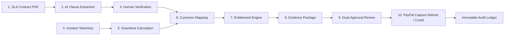

# PromiseBack — Enterprise SLA Compensation & Recovery Platform

> **AI-Powered Contract Intelligence, Outage Telemetry Mapping, Human Dual-Approval, and Automated PayPal Remedy Disbursement.**

[](https://nextjs.org/)
[](https://www.typescriptlang.org/)
[](https://tailwindcss.com/)
[](https://developer.paypal.com/)
[](https://www.apimatic.io/)
[](https://www.ag-grid.com/)
[](https://www.bryntum.com/)
[](https://promiseback.io)

---

## 1. Executive Summary

In high-growth SaaS and enterprise cloud infrastructure, standard SLA credits are fraught with friction:
1. **Dormant Contracts**: Service Level Agreements sit unread in static PDFs.
2. **Hidden Breaches**: Outage events occur, but customers fail to file claims within strict 30-day deadlines.
3. **Manual Entitlement Audits**: Finance teams spend days manually cross-referencing Datadog/CloudWatch metrics with contract tiers.
4. **Delayed Remediation**: Customers become disgruntled when financial remedies take months to process.

**PromiseBack transforms reactive SLA penalties into proactive customer trust and automated recovery.**

---

## 2. The 10-Step End-to-End Recovery Pipeline



1. **SLA Contract Ingestion**: Drag-and-drop PDF master agreements and addendums.
2. **Contract Intelligence**: AI extracts monthly uptime covenants, penalty tier escalations, and claim deadlines.
3. **Clause-Level Verification**: Compliance officers countersign extracted clauses; uncertain terms are flagged for review.
4. **Incident Ingestion**: Synthetic monitors and webhooks deliver real-time outage telemetry and root cause data.
5. **Downtime Calculation**: Computes exact deficit minutes and net monthly availability percentages.
6. **Customer Tenant Mapping**: Automatically resolves which accounts and infrastructure regions were degraded.
7. **Entitlement Calculation Engine**: Deterministically calculates contractual remedies using mathematical formulas.
8. **Evidence Generation**: Bundles telemetry logs, timestamps, affected clauses, and calculations into an immutable evidence dossier.
9. **Dual-Approval Review**: Structured two-column workbench allowing finance officers to review obligation vs. evidence and authorize payout.
10. **PayPal Capture Refund or Invoice Credit**: Direct disbursement via PayPal REST API v2 Payments & Captures (powered by APIMatic SDK), recorded on a cryptographic SHA-256 chained audit ledger.

---

## 3. Screen Overview

| Screen | Route | Description |
| :--- | :--- | :--- |
| **Executive Dashboard** | `/dashboard` | Service recovery overview, KPI metrics, 30-day time-series availability chart vs. 99.95% target, recent incidents, and operational intelligence panel. |
| **Contract Intelligence** | `/contracts` | Drag-and-drop PDF upload, AI extraction confidence tracking, and clause-level verification registry. |
| **Incident Intelligence** | `/incidents` | Outage event timeline, synthetic telemetry probes (availability, latency, error rate), and SLA correlation analysis. |
| **Customer Entitlements** | `/entitlements` | High-density data grid with multi-status filters, precise currency formatting, and detail slide-over drawers. |
| **Compensation Review** | `/compensation-review` | Two-column investigation layout (Contractual Obligation vs. Supporting Evidence), real action buttons (Approve, Request Review, Reject). |
| **Refunds & Credits** | `/refunds` | Distinct tabs for PayPal Payouts vs. Invoice Service Credits, transaction detail inspector, and live PayPal payload viewer. |
| **Audit Trail** | `/audit` | Chronological event ledger featuring SHA-256 cryptographic chaining with live integrity verification. |
| **Protected Customers** | `/customers` | Enterprise tenant directory with assigned SLA tiers, monthly spend, and preferred disbursement channels. |
| **System Settings** | `/settings` | PayPal Sandbox & Live credentials, dual-approval financial threshold configuration, and webhook ingestion endpoints. |

---

## 4. Design System & Tokens

Crafted using FAANG-grade SaaS design principles (Stripe, Linear, Mercury):
- **Background**: `#F6F8FC`
- **Surface**: `#FFFFFF`
- **Sidebar**: `#111827`
- **Primary Indigo**: `#5146E5` (Hover: `#4338CA`, Light: `#EEEDFF`)
- **Success Emerald**: `#139B76` (Background: `#E8F7F1`)
- **Warning Amber**: `#D99124` (Background: `#FFF5E5`)
- **Danger Crimson**: `#DC5555` (Background: `#FDECEC`)
- **Typography**: Inter
- **Icons**: Lucide Icons
- **Layout**: 240px persistent left sidebar, sticky top header with Command+K global search, real-time alert flyouts, and responsive mobile navigation drawer.

---

## 5. API Reference

- `GET /api/stats`: Executive dashboard metrics, availability time-series points, and operational intelligence.
- `GET /api/contracts` & `POST /api/contracts`: List contracts and upload new SLA agreements for AI clause parsing.
- `PATCH /api/contracts/:id`: Update clause verification status (`human_verified`, `requires_review`).
- `GET /api/incidents` & `POST /api/incidents`: Query incidents and ingest synthetic telemetry alerts.
- `GET /api/entitlements`: Filter calculated customer compensation cases.
- `POST /api/approvals`: Execute human review decisions (`approved`, `rejected`, `review_requested`).
- `GET /api/refunds` & `POST /api/refunds`: Query and execute PayPal Payouts and invoice credit deductions.
- `GET /api/audit`: Query historical event records with cryptographic SHA-256 chain verification.
- `POST /api/ai/analyze`: Context-aware AI analysis for contracts, incidents, and compensation cases.

---

## 6. Getting Started

### Prerequisites
- Node.js v18.0.0 or higher
- npm 9.0.0 or higher

### Installation & Run

```bash
# 1. Install dependencies
npm install

# 2. Run Next.js production build
npm run build

# 3. Start production server
npm start
```

Open [http://localhost:3000](http://localhost:3000) in your browser.
