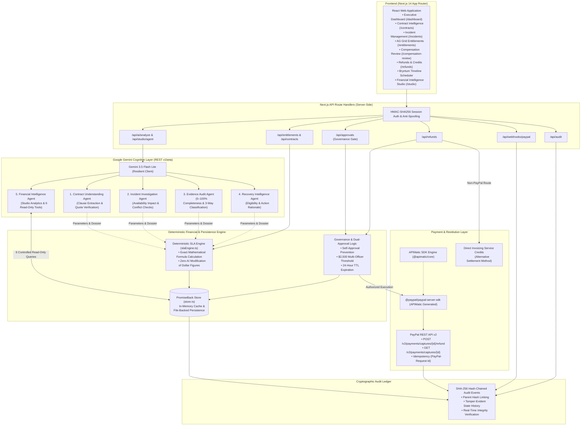
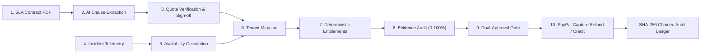

# PromiseBack — Enterprise SLA Compensation & Recovery Platform

> **"From Missed Commitments to Money Recovered."**  
> *An AI-powered SLA recovery and financial governance platform that converts missed service commitments into evidence-backed financial recovery opportunities through automated contract intelligence, telemetry investigation, deterministic financial calculation, dual-approval governance, and PayPal REST API v2 capture refunds.*

[](LICENSE)
[](https://nextjs.org/)
[](https://www.typescriptlang.org/)
[](https://tailwindcss.com/)
[](https://developer.paypal.com/)
[](https://www.apimatic.io/)
[](https://ai.google.dev/)
[](https://www.ag-grid.com/)
[](https://www.bryntum.com/products/scheduler/)

---

## Table of Contents

1. [Project Overview](#1-project-overview)
2. [The Problem](#2-the-problem)
3. [Inspiration](#3-inspiration)
4. [What PromiseBack Does](#4-what-promiseback-does)
5. [Key Features](#5-key-features)
6. [Multi-Agent AI Architecture](#6-multi-agent-ai-architecture)
7. [How the Five Gemini Agents Work](#7-how-the-five-gemini-agents-work)
8. [System Architecture](#8-system-architecture)
9. [End-to-End Workflow](#9-end-to-end-workflow)
10. [Deterministic Financial Calculation Engine](#10-deterministic-financial-calculation-engine)
11. [Financial Governance and Human Approval](#11-financial-governance-and-human-approval)
12. [PayPal Integration](#12-paypal-integration)
13. [Financial Intelligence Studio](#13-financial-intelligence-studio)
14. [SHA-256 Audit Ledger](#14-sha-256-audit-ledger)
15. [Technology Stack](#15-technology-stack)
16. [Project Structure](#16-project-structure)
17. [Installation and Setup](#17-installation-and-setup)
18. [Environment Variables](#18-environment-variables)
19. [Running the Application](#19-running-the-application)
20. [Running Tests](#20-running-tests)
21. [Demo Scenario](#21-demo-scenario)
22. [Testing Instructions for Hackathon Judges](#22-testing-instructions-for-hackathon-judges)
23. [Security Considerations](#23-security-considerations)
24. [Current Limitations](#24-current-limitations)
25. [Future Scope](#25-future-scope)
26. [Sponsor Technology Integrations](#26-sponsor-technology-integrations)
27. [Hackathon Project Information](#27-hackathon-project-information)
28. [License](#28-license)

---

## 1. Project Overview

**PromiseBack** is an enterprise-grade financial governance and Service Level Agreement (SLA) recovery platform developed for the **PayPal AI Hackathon 2026**.

In mission-critical enterprise SaaS and cloud infrastructure, uptime and latency covenants are legally binding commitments. When infrastructure experiences an outage, customers are contractually entitled to financial restitution in the form of service credits or refunds. Today, however, SLA compensation is broken: contracts remain locked in dormant PDFs, outages are manually audited against fragmented monitoring dashboards, claims expire before filing deadlines, and financial reconciliation takes months of adversarial negotiation.

PromiseBack automates this entire lifecycle:
$$\text{Contract} \longrightarrow \text{Incident} \longrightarrow \text{Investigation} \longrightarrow \text{Recovery Analysis} \longrightarrow \text{Financial Validation} \longrightarrow \text{Human Approval} \longrightarrow \text{PayPal Execution} \longrightarrow \text{Audit}$$

The platform couples **Google Gemini** for semantic contract understanding and forensic evidence auditing with an isolated **deterministic financial calculation engine**, **institutional dual-approval governance**, and automated electronic restitution via **PayPal REST API v2 capture refunds**, recording every lifecycle state transition on a tamper-evident **SHA-256 hash-chained audit ledger**.

---

## 2. The Problem

Service Level Agreements represent billions of dollars in enterprise contractual commitments, but their enforcement is crippled by four systemic friction points:

1. **Dormant Contracts**: High-value SLA agreements, penalty schedules, and cure provisions sit trapped in unparsed PDF documents and legal addenda, completely disconnected from operational monitoring systems.
2. **Unclaimed Outages & Expiring Deadlines**: Outages occur frequently, but enterprise customers miss narrow 15- to 30-day contractual claim submission windows because identifying affected covenants requires tedious log forensics.
3. **Manual, Error-Prone Entitlement Audits**: Finance, DevOps, and legal teams spend weeks manually cross-referencing monitoring metrics against multi-tier SLA matrices. Calculating fractional availability deficits (e.g., $99.912\%$ vs. $99.95\%$) and evaluating maintenance exclusions creates friction and disputes.
4. **Delayed Restitution & Lost Customer Trust**: Even when breaches are undisputed, issuing remedies through manual billing cycles takes months. Customers feel cheated when commitments are broken without timely restitution.

---

## 3. Inspiration

When enterprise cloud providers experience downtime, their status pages display post-mortems while enterprise customers tally revenue losses. The contractual safety net—the SLA—rarely works as intended. Customers must prove the downtime, cite specific contract clauses, calculate complex percentage deficits, and submit formal claims before arbitrary deadlines.

We asked: **What if an enterprise financial platform could continuously monitor contractual promises, forensically audit outage evidence, calculate exact compensation deterministically, require authorized human review, and disburse electronic restitution directly through PayPal?**

PromiseBack bridges the gap between unstructured legal promises, infrastructure telemetry, and institutional payment rails—turning missed commitments into money recovered.

---

## 4. What PromiseBack Does

PromiseBack provides a continuous, automated SLA recovery pipeline:

1. **Understands SLA Contracts**: Extracts uptime covenants, measurement periods, penalty tiers, exclusion clauses, and claim deadlines from uploaded PDF agreements using Google Gemini, verifying extracted quotations verbatim against the source text.
2. **Investigates Infrastructure Incidents**: Correlates outage events against contractual commitments, computes 30-day availability impact, evaluates maintenance exclusion windows, and checks timestamp consistency.
3. **Audits Evidential Completeness**: Analyzes telemetry dossiers to generate an objective **0–100% Evidence Completeness Score**, categorizing proof into `VERIFIED`, `CONTRADICTORY`, and `MISSING` items.
4. **Calculates Exact Restitution Deterministically**: Enforces an architectural firewall where AI provides legal interpretation, but an isolated deterministic engine computes exact dollar compensation ($14,500.00 base fee $\times$ 10% tier = $1,450.00).
5. **Enforces Dual-Approval Governance**: Prohibits creator self-approval and escalates high-value claims (exceeding **$2,500.00**) to mandatory multi-officer authorization with 24-hour TTL expiration.
6. **Executes Electronic PayPal Restitution**: Issues instant electronic refunds against original captured payments via **PayPal REST API v2 Capture Refunds** using the APIMatic-generated PayPal Server SDK.
7. **Maintains Cryptographic Auditability**: Anchors every action, approval, and refund into a **SHA-256 parent-hash-chained audit ledger** with on-demand integrity verification.
8. **Empowers Financial Intelligence**: Delivers interactive financial analytics through AG Studio, equipped with 6 read-only database tools and an immutable security guardrail against autonomous financial execution.

---

## 5. Key Features

- **Semantic SLA Contract Extraction**: Ingests master agreements, extracting uptime thresholds, penalty schedules, cure windows, and claim submission deadlines.
- **Verbatim Quote Verification Engine**: Algorithmic sliding-window verification cross-checks extracted clauses against raw PDF text, flagging unverified terms to eliminate hallucinated covenants.
- **Forensic Telemetry & Outage Correlation**: Computes 30-day availability impact ($\frac{43,200 - \text{downtime}}{43,200} \times 100$), detects chronology inversions, and separates confirmed facts from operational inferences.
- **Quantitative Evidence Completeness Scoring**: Evaluates evidence dossiers with an objective 0–100% score and three-way classification (`VERIFIED`, `CONTRADICTORY`, `MISSING`).
- **Deterministic SLA Calculation Engine**: Strict mathematical isolation ensures currency figures are calculated solely by deterministic code; AI cannot invent, alter, or round monetary amounts.
- **Institutional Multi-Officer Governance**: Configurable approval threshold ($2,500.00), creator self-approval prohibition, dual-officer sign-off, and amount tamper protection.
- **PayPal REST API v2 Capture Refunds**: Direct electronic refund execution against captured transactions with `PayPal-Request-Id` server-side idempotency protection.
- **Alternative Invoice Service Credits**: Supports contractually mandated non-electronic remedies via automated billing credit ledgers.
- **AG Grid High-Density Entitlements Table**: High-performance interactive grid on `/entitlements` with sorting, filtering, and custom cell status renderers.
- **AG Studio Financial Intelligence**: Conversational analytics on `/studio` with 6 controlled read-only database tools and an immutable financial execution refusal guardrail.
- **Bryntum Scheduler Outage Timeline**: Visualizes incident durations, synthetic canary probe degradation, and maintenance windows on `/incidents`.
- **SHA-256 Hash-Chained Audit Ledger**: Cryptographically linked event ledger with parent hash verification and on-demand tamper detection on `/audit`.

---

## 6. Multi-Agent AI Architecture

PromiseBack implements a five-agent cognitive architecture powered by **Google Gemini** (`gemini-3.5-flash-lite` via REST API `v1beta`). Rather than relying on a single monolithic prompt, each agent operates within a dedicated cognitive boundary:

```
src/lib/ai/
├── geminiClient.ts      # Resilient REST client with schema validation & latency fallback
├── contractAgent.ts     # 1. Contract Understanding Agent
├── incidentAgent.ts     # 2. Incident Investigation Agent
├── evidenceAuditor.ts   # 3. Evidence Audit Agent
├── recoveryAgent.ts     # 4. Recovery Intelligence Agent
├── financialAgent.ts    # 5. Financial Intelligence Agent
└── index.ts             # Barrel export
```

### Architectural Principles

1. **Role Specialization**: Each agent has an isolated system prompt, JSON output schema, and operational domain.
2. **Probabilistic Interpretation vs. Deterministic Arithmetic**: Gemini evaluates natural language, contract semantics, evidentiary completeness, and recommendations. The deterministic calculation engine ([`slaEngine.ts`](src/lib/slaEngine.ts)) holds exclusive authority over currency values.
3. **Structured Outputs**: All agents return validated, strongly-typed JSON schemas.
4. **Resilient Multi-Model Fallback**: The client prioritizes `gemini-3.5-flash-lite` and automatically rotates through `gemini-3.1-flash-lite`, `gemini-3-flash-preview`, and `gemini-3.5-flash` upon rate-limits or timeouts.
5. **Deterministic Offline Fallbacks**: If Gemini credentials are not configured or network access fails, high-precision rule-based fallback modules execute, clearly badged as *Deterministic Fallback* in the UI.

---

## 7. How the Five Gemini Agents Work

### 1. Contract Understanding Agent (`src/lib/ai/contractAgent.ts`)
- **Objective**: Ingests and interprets full-text and PDF SLA agreements.
- **Extraction Scope**: Monthly availability targets (e.g., 99.95%), tiered penalty schedules, measurement periods, downtime allowances, cure periods, and claim submission windows.
- **Verbatim Quote Validation**: Executes `validateSourceQuoteInText` to ensure every extracted commitment exists verbatim in the document, scoring quote authenticity and flagging paraphrased or unverified terms.
- **Downtime Allowance**: Calculates exact permissible downtime (e.g., $99.95\%$ target allows at most 21.6 minutes/month).

### 2. Incident Investigation Agent (`src/lib/ai/incidentAgent.ts`)
- **Objective**: Performs forensic correlation between outage telemetry and contractual covenants.
- **Availability Impact**: Computes net monthly availability ceiling: $\text{Availability} = \frac{43,200 - \text{downtime}}{43,200} \times 100$.
- **Timestamp Conflict Detection**: Audits chronologies via `checkTimestampConsistency` (flags detection before start, resolution before start, or future timestamps).
- **Maintenance Exclusions**: Evaluates whether outages occurred during pre-notified maintenance windows (`isMaintenanceWindow`).
- **Facts vs. Inferences**: Separates confirmed telemetry facts from operational inferences, preventing premature declarations of legal liability on incomplete data.

### 3. Evidence Audit Agent (`src/lib/ai/evidenceAuditor.ts`)
- **Objective**: Forensic evidentiary completeness auditing prior to compensation review.
- **Three-Way Classification**: Categorizes all evidential artifacts into:
  - `VERIFIED`: Confirmed by telemetry logs or verified contract clauses.
  - `CONTRADICTORY`: Conflicting records (e.g., claimed outage exceeds synthetic probe duration).
  - `MISSING`: Required proof not yet attached (e.g., post-mortem root cause analysis).
- **Completeness Scoring**: Computes an objective **0–100% Evidence Completeness Score**.
- **Risk Identification**: Outlines specific evidential gaps that would expose the organization to financial risk if approved.

### 4. Recovery Intelligence Agent (`src/lib/ai/recoveryAgent.ts`)
- **Objective**: Synthesizes contractual terms, incident findings, and evidence completeness into actionable recovery recommendations.
- **Recommendation Verdict**: Issues structured verdicts (`RECOMMEND_FULL_PAYOUT`, `RECOMMEND_PARTIAL_PAYOUT`, `REQUEST_ADDITIONAL_EVIDENCE`, `RECOMMEND_REJECTION`).
- **Mathematical Invariant**: **Does not calculate or alter currency figures**. It cites the exact dollar entitlement calculated by `slaEngine.ts` and references the mathematical formula.
- **Governance Routing**: Checks the `$2,500.00` dual-approval threshold and selects the restitution channel (PayPal Refund vs. Invoice Credit).

### 5. Financial Intelligence Agent (`src/lib/ai/financialAgent.ts`)
- **Objective**: Powers the natural-language conversational analytics workbench in Financial Intelligence Studio (AG Studio).
- **Tool-Augmented Reasoning**: Equipped with **6 controlled, read-only database query tools**:
  1. `getFinancialSummary()`: Aggregate liability, pending remedies, and disbursed refunds.
  2. `getTopExposureCustomers()`: Exposure ranking by customer.
  3. `getApproachingDeadlines()`: SLA cases nearing claim deadlines.
  4. `getConflictingIncidents()`: Incidents with missing or conflicting evidence.
  5. `getServiceReliability()`: Historical service degradation statistics.
  6. `getCaseHistory()`: Deep-dive compensation case records.
- **Record Citing**: Cites real record identifiers (`CASE-...`, `INC-...`, `SLA-...`).
- **Immutable Security Guardrail**: Enforces an unbypassable guardrail notice prohibiting autonomous fund movement or approval bypass.

---

## 8. System Architecture

The architecture enforces strict separation between client presentation, server API routes, cognitive AI reasoning, deterministic financial arithmetic, payment execution, and cryptographic audit logging:



---

## 9. End-to-End Workflow

The platform coordinates a 10-step recovery pipeline:



1. **SLA Contract Ingestion**: Ingests PDF agreements or structured contracts.
2. **AI Clause Extraction**: Gemini extracts uptime covenants, penalty tier escalations, and claim deadlines into structured JSON schemas.
3. **Quote Verification & Human Sign-off**: Verifies extracted quotes verbatim against raw document text; compliance officers countersign clauses.
4. **Incident Telemetry Ingestion**: Captures outage telemetry, duration, impacted service endpoints, and error rates.
5. **Availability Calculation**: Computes net monthly availability percentage and evaluates pre-scheduled maintenance exclusion windows.
6. **Customer Tenant Mapping**: Maps impacted services and infrastructure regions to affected enterprise customer accounts.
7. **Deterministic Entitlements Engine**: Evaluates breach magnitude against contractual compensation tiers to compute exact monetary remedies.
8. **Forensic Evidence Audit**: Computes an objective 0–100% completeness score and categorizes evidence into Verified, Contradictory, and Missing items.
9. **Dual-Approval Gate**: Evaluates payout thresholds ($2,500.00) and enforces separation of duties before financial authorization.
10. **Restitution & Cryptographic Audit**: Issues a PayPal REST API v2 Capture Refund or invoice credit, recording the transaction on the SHA-256 hash-chained ledger.

---

## 10. Deterministic Financial Calculation Engine

### Why Financial Calculations Are Deterministic

Large Language Models are probabilistic and prone to arithmetic approximations. In enterprise financial governance, a calculation that rounds $\$1,450.00$ to $\$1,500.00$ introduces financial leakage and legal liability.

PromiseBack enforces an architectural boundary:
- **Google Gemini**: Responsible for semantic interpretation of contractual text, identifying qualifying clauses, evaluating evidence completeness, and explaining rationale.
- **Deterministic Engine (`src/lib/slaEngine.ts`)**: Responsible for arithmetic calculations.

### The Mathematical Formula

1. **Measurement Period Minutes**:
   $$\text{Total Minutes} = \text{Billing Days} \times 24 \times 60 = 30 \times 1440 = 43,200 \text{ minutes}$$
2. **Net Availability Percentage**:
   $$\text{Availability} = \left(\frac{\text{Total Minutes} - \text{Downtime Minutes}}{\text{Total Minutes}}\right) \times 100$$
   $$\text{Example (38 min outage)}: \frac{43,200 - 38}{43,200} \times 100 = 99.912\%$$
3. **Breach Magnitude**:
   $$\text{Breach Deficit} = \text{Target Availability} - \text{Measured Availability} = 99.95\% - 99.912\% = 0.038\%$$
4. **Tier Evaluation & Entitlement Amount**:
   $$\text{Applicable Tier}: 99.50\% \text{ to } 99.94\% \longrightarrow \text{Tier 1 (10\% Credit)}$$
   $$\text{Entitlement Amount} = \text{Monthly Base Fee} \times \text{Credit Percentage} = \$14,500.00 \times 10\% = \mathbf{\$1,450.00}$$

---

## 11. Financial Governance and Human Approval

PromiseBack enforces institutional banking and governance safeguards:

- **Human Approval Gate**: AI cannot execute or disburse refunds autonomously. Financial authorization requires an authenticated operator decision (`approved`, `rejected`, `review_requested`) in the Compensation Review workbench (`/compensation-review`).
- **Dual-Approval Threshold**: Claims exceeding the configured threshold (default: **$2,500.00**) mandate two distinct authorized officers:
  - **Stage 1**: Financial Review (Finance Controller or Officer).
  - **Stage 2**: Executive Authorization (Executive Director, Legal Counsel, or CFO).
- **Separation of Duties**: The officer who initiates or requests a compensation case is prohibited from approving it. In dual-approval cases, the same individual cannot perform both Stage 1 and Stage 2 approvals.
- **Approval Expiry (24-Hour TTL)**: Stage 1 approvals expire after 24 hours if Stage 2 executive sign-off is not completed, reverting the case to `requires_review`.
- **Amount Tampering Protection**: If the claim's calculated amount is altered after Stage 1 approval is granted, Stage 2 approval is rejected with an `APPROVAL_AMOUNT_MISMATCH` error.
- **HMAC-SHA256 Session Management**: Operator sessions use tamper-evident signed cookies. Unauthenticated requests or spoofed client headers (`x-promiseback-client`) are rejected with HTTP 401.

---

## 12. PayPal Integration

PromiseBack integrates with PayPal using technically accurate payment primitives:

### PayPal REST API v2 Capture Refunds

The primary automated restitution mechanism is **PayPal REST API v2 Capture Refunds**:
```http
POST /v2/payments/captures/{capture_id}/refund
```

When an enterprise customer subscribes to a cloud service, their subscription fee is captured under a PayPal Capture ID (e.g., `2GG10928AB778901C`). When an SLA breach is approved, PromiseBack issues a capture refund directly against that original payment capture.

- **PayPal Server SDK**: Powered by `@paypal/paypal-server-sdk` (`v2.5.0`), officially generated by **APIMatic** using `@apimatic/core` and `@apimatic/schema`.
- **OAuth 2.0 Client Credentials**: Managed via `getPayPalSandboxAccessToken` with in-memory caching and 60-second expiration buffer to prevent unnecessary roundtrips.
- **Pre-Refund Capture Inspection**: `GET /v2/payments/captures/{capture_id}` inspects the capture to verify `COMPLETED` status, currency match, and remaining refundable balance (`capture.refundableBalance`).
- **Idempotency Protection**: Every refund request passes a unique `PayPal-Request-Id` header (composed as `cust-id:billing-period:inc-id`) ensuring network retries never cause duplicate refunds.
- **Inbound Webhook Verification**: Inbound webhooks (`PAYMENT.CAPTURE.REFUNDED`) are cryptographically verified against PayPal's verification endpoint (`POST /v1/notifications/verify-webhook-signature`) and recorded idempotently.
- **Environment**: **PayPal Developer Sandbox** (`https://api-m.sandbox.paypal.com`).

### Refund Workflow Sequence

```
Eligible Captured Payment (2GG10928AB778901C)
  │
  ▼
AI Recovery Recommendation (Recovery Intelligence Agent)
  │
  ▼
Deterministic Calculation ($14,500.00 × 10% = $1,450.00 via slaEngine.ts)
  │
  ▼
Human Approval & Governance Gate (Compensation Review Workbench)
  │
  ▼
PayPal Capture Refund (POST /v2/payments/captures/{id}/refund)
  │
  ▼
Cryptographic Audit Ledger Entry (SHA-256 Hash-Chained Record)
```

### Clarification of Restitution Channels

| Restitution Method | Technical Mechanism | Implementation Status |
| :--- | :--- | :---: |
| **PayPal Capture Refunds** | Reverses funds from a previously captured PayPal payment via `POST /v2/payments/captures/{id}/refund`. | **IMPLEMENTED & VERIFIED** |
| **Invoice Service Credits** | Applies a credit balance against the customer's next billing invoice via deterministic ledger deduction. | **IMPLEMENTED & VERIFIED** |
| **PayPal Payouts** | Outbound mass disbursement from a business account balance via `POST /v1/payments/payouts`. | **NOT IMPLEMENTED** (Roadmap) |

> [!IMPORTANT]
> PromiseBack executes **PayPal capture refunds** and **invoice service credits**. It does **not** use the PayPal Payouts API.

---

## 13. Financial Intelligence Studio

The **Financial Intelligence Studio** (`/studio`) provides an interactive analytical workbench powered by AG Studio (`ag-studio-react`):

- **Natural-Language Inquiries**: Supports executive questions such as:
  - *"Which service providers have caused the highest financial exposure?"*
  - *"Which recovery opportunities are approaching their claim deadlines?"*
  - *"Which incidents have conflicting downtime records?"*
  - *"What is our outstanding recoverable amount?"*
- **6 Controlled Read-Only Tools**: The agent executes database queries against the live store (`store.getEntitlements()`, `store.getRefunds()`, `store.getIncidents()`, `store.getCustomers()`) and passes structured context to Gemini.
- **Record Citing**: Responses cite real database identifiers (`CASE-...`, `INC-...`, `SLA-...`).
- **Immutable Security Guardrail**: Enforces a strict guardrail:
  > *"AI Financial Security Guardrail Enforced: Financial Intelligence Agent provides analytical, forensic, and query intelligence only. Direct financial disbursement, refund creation, and approval bypass are strictly prohibited. All financial disbursements require human dual-approval authorization in the Compensation Review workbench."*

---

## 14. SHA-256 Audit Ledger

Every state mutation in PromiseBack generates an immutable, cryptographically chained audit event:

### Cryptographic Chaining Specification

Each audit event incorporates the SHA-256 hash of the immediately preceding event:
$$\text{Hash}_n = \text{SHA-256}(\text{Index}_n \parallel \text{Timestamp}_n \parallel \text{EventType}_n \parallel \text{PayloadJSON}_n \parallel \text{Hash}_{n-1})$$

The genesis event begins with a known seed hash (`0000000000000000000000000000000000000000000000000000000000000000`).

### On-Demand Ledger Verification

The `/audit` interface provides a **"Verify Ledger Integrity"** capability (`GET /api/audit`). The verification engine traverses the entire chain from genesis to the latest record, recomputing hashes and validating parent linkages. Any modification, reordering, or deletion of a past record immediately breaks the hash chain and flags the exact corrupted event index.

---

## 15. Technology Stack

| Category | Technology | Version | Official Documentation | Role in PromiseBack |
| :--- | :--- | :--- | :--- | :--- |
| **Framework** | [Next.js](https://nextjs.org/) | `14.2.15` | [nextjs.org/docs](https://nextjs.org/docs) | App Router, React Server Components, Route Handlers. |
| **Language** | [TypeScript](https://www.typescriptlang.org/) | `5.6.3` | [typescriptlang.org/docs](https://www.typescriptlang.org/docs/) | End-to-end type safety, strict interface contracts. |
| **Styling** | [Tailwind CSS](https://tailwindcss.com/) | `3.4.14` | [tailwindcss.com/docs](https://tailwindcss.com/docs) | Design system, tokenized layout, responsive styling. |
| **Payment Rails** | [PayPal REST API v2](https://developer.paypal.com/) | `v2` | [developer.paypal.com/api/rest](https://developer.paypal.com/api/rest/) | Electronic restitution via Capture Refunds (`/v2/payments/captures/{id}/refund`). |
| **SDK Generation** | [APIMatic](https://www.apimatic.io/) | `@apimatic/core 0.10.30` | [apimatic.io/docs](https://www.apimatic.io/docs) | Generates and powers `@paypal/paypal-server-sdk` (`v2.5.0`) with schema validation. |
| **AI / LLM** | [Google Gemini](https://ai.google.dev/) | `REST v1beta` | [ai.google.dev/docs](https://ai.google.dev/docs) | Multi-agent reasoning layer (`gemini-3.5-flash-lite`) with JSON Schema structured outputs. |
| **Data Grid** | [AG Grid](https://www.ag-grid.com/) | `36.3.0` | [ag-grid.com/react-data-grid](https://www.ag-grid.com/react-data-grid/) | High-density entitlements table (`ag-grid-react`, Quartz theme) on `/entitlements`. |
| **Financial Studio** | [AG Studio](https://www.ag-grid.com/) | `3.1.0` | [ag-grid.com](https://www.ag-grid.com/) | Interactive conversational financial analytics studio (`ag-studio-react`) on `/studio`. |
| **Timeline Scheduling** | [Bryntum Scheduler](https://www.bryntum.com/products/scheduler/) | `7.3.8` | [bryntum.com/products/scheduler/docs](https://www.bryntum.com/products/scheduler/docs/) | Outage, detection lag, and maintenance timeline component on `/incidents`. |
| **Document Parsing** | [pdf-parse](https://www.npmjs.com/package/pdf-parse) | `2.4.5` | [npmjs.com/package/pdf-parse](https://www.npmjs.com/package/pdf-parse) | Server-side PDF text buffer extraction for SLA contract ingestion. |
| **Cryptography** | [Node.js Crypto](https://nodejs.org/api/crypto.html) | Native | [nodejs.org/api/crypto.html](https://nodejs.org/api/crypto.html) | HMAC-SHA256 session management and parent-hash-chained audit logging. |

---

## 16. Project Structure

```
PromiseBack/
├── .env.example                               # Environment template (placeholders only)
├── .gitignore                                 # Excludes .env, secrets, and runtime data
├── package.json                               # Dependencies and npm scripts
├── README.md                                  # Comprehensive technical documentation
├── data/
│   ├── store.demo.json                        # Pre-seeded demonstration dataset
│   └── store.json                             # Active runtime store (gitignored)
├── src/
│   ├── app/                                   # Next.js 14 App Router
│   │   ├── api/                               # Server-side API Route Handlers
│   │   │   ├── ai/analyze/route.ts            # AI analysis (contract, incident, evidence, recovery)
│   │   │   ├── approvals/route.ts             # Governance approval & dual-approval execution
│   │   │   ├── audit/route.ts                 # SHA-256 audit ledger query & verification
│   │   │   ├── auth/session/route.ts          # Operator session authentication
│   │   │   ├── checkout/route.ts              # Sandbox checkout & test capture generator
│   │   │   ├── contracts/route.ts             # Contract ingestion (PDF/JSON)
│   │   │   ├── contracts/[id]/route.ts        # Contract lookup & clause verification
│   │   │   ├── customers/route.ts             # Customer profiles & refundable balances
│   │   │   ├── entitlements/route.ts          # Calculated customer compensation cases
│   │   │   ├── incidents/route.ts             # Outage incident ingestion & lookup
│   │   │   ├── incidents/[id]/route.ts        # Detailed incident & canary telemetry
│   │   │   ├── refunds/route.ts               # PayPal capture refund execution
│   │   │   ├── stats/route.ts                 # Dashboard KPI metrics & time-series
│   │   │   ├── studio/agent/route.ts          # Financial Intelligence Agent chat endpoint
│   │   │   └── webhooks/paypal/route.ts       # PayPal inbound webhook verification
│   │   ├── audit/page.tsx                     # Cryptographic Audit Ledger screen
│   │   ├── compensation-review/page.tsx       # Two-column Investigation & Review workbench
│   │   ├── contracts/page.tsx                 # Contract Intelligence screen
│   │   ├── customers/page.tsx                 # Protected Customers screen
│   │   ├── dashboard/page.tsx                 # Executive Dashboard screen
│   │   ├── entitlements/page.tsx              # AG Grid Customer Entitlements screen
│   │   ├── incidents/page.tsx                 # Incident Intelligence & Bryntum Scheduler screen
│   │   ├── login/page.tsx                     # Operator Login screen
│   │   ├── refunds/page.tsx                   # Refunds & Credits terminal
│   │   ├── settings/page.tsx                  # System Settings & Credentials screen
│   │   └── studio/page.tsx                    # Financial Intelligence Studio screen
│   ├── components/                            # Modular React UI components
│   │   ├── contracts/                         # Upload modals, clause verifiers, detail drawers
│   │   ├── dashboard/                         # KPI cards, performance charts, operational feed
│   │   ├── entitlements/                      # AG Grid table & detail slide-overs
│   │   ├── incidents/                         # Bryntum Incident Scheduler & timeline components
│   │   ├── layout/                            # AppShell, Header, Sidebar navigation
│   │   ├── refunds/                           # Transaction detail drawer & payload inspector
│   │   ├── studio/                            # Financial Intelligence Studio component
│   │   └── ui/                                # AiIntelligencePanel, Badges, Buttons, Cards, Modals
│   ├── lib/                                   # Core services & engines
│   │   ├── ai/                                # Five specialized Gemini agents & resilient client
│   │   │   ├── contractAgent.ts               # Contract Understanding Agent
│   │   │   ├── incidentAgent.ts               # Incident Investigation Agent
│   │   │   ├── evidenceAuditor.ts             # Evidence Audit Agent
│   │   │   ├── recoveryAgent.ts               # Recovery Intelligence Agent
│   │   │   ├── financialAgent.ts              # Financial Intelligence Agent
│   │   │   ├── geminiClient.ts                # Resilient Gemini REST client with fallback
│   │   │   └── index.ts                       # Barrel export
│   │   ├── auth.ts                            # HMAC-SHA256 session management & anti-spoofing
│   │   ├── contractExtractor.ts               # PDF buffer text parsing
│   │   ├── contractIntelligence.ts            # Algorithmic quote verification
│   │   ├── paypal.ts                          # PayPal REST API v2 client & APIMatic integration
│   │   ├── slaEngine.ts                       # Deterministic availability & entitlement engine
│   │   └── store.ts                           # Persistence store, governance logic, SHA-256 ledger
│   └── types/                                 # TypeScript interfaces & domain models
└── tests/                                     # Automated test suites
    ├── ai-intelligence-layer.test.ts          # Test suite for all 5 Gemini agents
    ├── contract-extraction.test.ts            # Contract extraction tests
    ├── dual-approval-governance.test.ts       # Governance & dual approval tests
    ├── e2e-workflow.test.ts                   # End-to-end recovery workflow tests
    ├── financial-security.test.ts             # Financial security & mutation authorization tests
    ├── ledger-reconciliation.test.ts          # SHA-256 ledger reconciliation tests
    ├── paypal-integration.test.ts             # PayPal capture refund integration tests
    ├── redirect-persistence.test.ts           # State persistence tests
    ├── run-all-tests.js                       # Native test runner script
    ├── second-review.test.ts                  # Second-stage review tests
    ├── sla-calculation.test.ts                # Deterministic SLA calculation tests
    ├── sponsor-integrations.test.ts           # Sponsor tools integration tests
    ├── third-review.test.ts                   # Multi-stage review tests
    └── webhook-reconciliation.test.ts         # PayPal webhook reconciliation tests
```

---

## 17. Installation and Setup

### Prerequisites

- **Node.js**: `v18.0.0` or higher (`v20.x` recommended)
- **npm**: `v9.0.0` or higher
- **Git**

### Installation Steps

```bash
# 1. Clone the repository
git clone https://github.com/shivam-more1609/PromiseBack.git
cd PromiseBack

# 2. Install dependencies
npm install

# 3. Create your local environment configuration file
cp .env.example .env.local
```

---

## 18. Environment Variables

Configure your credentials in `.env.local` using [`.env.example`](.env.example) as the template:

| Variable | Required | Default / Example | Purpose |
| :--- | :---: | :--- | :--- |
| `ADMIN_USERNAME` | Yes | `admin` | Administrator username for operator login on `/login`. |
| `ADMIN_PASSWORD` | Yes | `your_secure_password_here` | Administrator password for operator login. |
| `PROMISEBACK_API_KEY` | Yes | `0aaeb2d7c41c...` | Server-side internal API key protecting mutation endpoints. |
| `SESSION_SECRET` | Yes | `f4897ebfae18...` | 32-byte secret used for HMAC-SHA256 session cookie signing. |
| `GEMINI_API_KEY` | Yes | `your_gemini_api_key_here` | Google Gemini API key enabling live AI cognitive agents. |
| `GEMINI_MODEL` | No | `gemini-3.5-flash-lite` | Preferred Gemini model. Fallbacks: `gemini-3.1-flash-lite`, `gemini-3-flash-preview`, `gemini-3.5-flash`. |
| `PAYPAL_SANDBOX_CLIENT_ID` | Optional | `your_sandbox_client_id` | PayPal Developer Sandbox Client ID for live sandbox refunds. |
| `PAYPAL_SANDBOX_CLIENT_SECRET` | Optional | `your_sandbox_client_secret` | PayPal Developer Sandbox Client Secret. |
| `PAYPAL_SANDBOX_WEBHOOK_ID` | Optional | `your_webhook_id` | PayPal Sandbox Webhook ID for webhook signature verification. |
| `NEXT_PUBLIC_APP_URL` | No | `http://localhost:3000` | Base application URL. |

> [!TIP]
> If PayPal Sandbox credentials are not provided, the platform automatically detects this and provides clear UI status pills explaining that Sandbox credentials are required for live PayPal API calls. High-precision mock simulations allow evaluation of UI workflows without credentials.

---

## 19. Running the Application

### Development Mode

Run the Next.js development server with hot-reloading:
```bash
npm run dev
```
Open [http://localhost:3000](http://localhost:3000) in your browser.

### Production Build & Execution

Verify compilation and start the production server:
```bash
# Build the optimized production bundle (checks TypeScript, linting, compiles static pages)
npm run build

# Start the Next.js production server
npm start
```
Open [http://localhost:3000](http://localhost:3000) in your browser.

---

## 20. Running Tests

PromiseBack includes an automated verification harness covering SLA mathematics, financial guardrails, contract intelligence, PayPal capture refunds, dual-officer governance, webhook reconciliation, and cognitive AI agents.

Run all 13 automated test suites:
```bash
npm test
```

### Verified Test Suite Results (13/13 Passing)

```
=== RUNNING ALL 13 TEST SUITES ===

Executing: tests/sla-calculation.test.ts ......... ✅ PASSED
Executing: tests/financial-security.test.ts ...... ✅ PASSED
Executing: tests/contract-extraction.test.ts ..... ✅ PASSED
Executing: tests/paypal-integration.test.ts ...... ✅ PASSED
Executing: tests/e2e-workflow.test.ts ............ ✅ PASSED
Executing: tests/second-review.test.ts ........... ✅ PASSED
Executing: tests/third-review.test.ts ............ ✅ PASSED
Executing: tests/sponsor-integrations.test.ts .... ✅ PASSED
Executing: tests/webhook-reconciliation.test.ts .. ✅ PASSED
Executing: tests/redirect-persistence.test.ts .... ✅ PASSED
Executing: tests/ledger-reconciliation.test.ts ... ✅ PASSED
Executing: tests/dual-approval-governance.test.ts  ✅ PASSED
Executing: tests/ai-intelligence-layer.test.ts ... ✅ PASSED

========================================
TEST SUITE RESULTS: 13/13 PASSED
========================================
```

---

## 21. Demo Scenario

> [!NOTE]
> **SYNTHETIC DEMONSTRATION DATA NOTICE**:  
> The scenario below uses synthetic enterprise records seeded in [`data/store.demo.json`](data/store.demo.json) for hackathon evaluation purposes. It does not reflect an actual outage suffered by a real corporation, nor real funds recovered.

### Flagship Scenario Parameters

- **Customer**: Acropora Cloud Infrastructure Inc. / Apex Fintech Solutions Inc. (`cust-101`)
- **Contract Number**: `SLA-2026-AF88` (Enterprise Mission-Critical Gold SLA)
  - Contracted Monthly Uptime Target: **99.95%**
  - Monthly Recurring Charge: **$14,500.00**
  - Claim Submission Window: **30 calendar days**
  - Remedy Tier 1: **99.50% – 99.94%** $\longrightarrow$ **10% credit**
  - Restitution Channel: **PayPal Refund** against capture `2GG10928AB778901C`
- **Incident Record**: `INC-2026-0314`
  - Service: Core Transaction Routing & Payment Webhook Ingestion
  - Severity: **P1 – Critical**
  - Outage Duration: **38 minutes**
  - Root Cause: Connection pool deadlock on `transactions_ledger` primary replica
- **Net Availability Calculation**:
  $$\text{Availability} = \frac{43,200 - 38}{43,200} \times 100 = 99.912\%$$
  $99.912\% < 99.95\%$ target $\longrightarrow$ **Breach Confirmed**, activating Tier 1 (10% credit).
- **Exact Deterministic Entitlement**:
  $$\text{Remedy Amount} = \$14,500.00 \times 10\% = \mathbf{\$1,450.00}$$
- **Evidence Completeness Score**: **85/100** (3 verified items: telemetry metrics, clause 4.3 authority, root cause; 1 missing item: maintenance calendar check; 0 contradictions).
- **Governance Gate**: Amount ($1,450.00) is below the $2,500.00 threshold, allowing single-officer sign-off while preventing creator self-approval.
- **PayPal Execution**: Disbursed via PayPal REST API v2 Capture Refund against capture `2GG10928AB778901C`.
- **Audit Verification**: Recorded on the cryptographic ledger with verified parent hash chaining.

---

## 22. Testing Instructions for Hackathon Judges

Hackathon judges can evaluate the complete end-to-end workflow following this guided path:

### Step 1: Operator Authentication
1. Navigate to [`/login`](http://localhost:3000/login).
2. Enter the administrator credentials configured in your `.env.local` file:
   - **Username**: Value of `ADMIN_USERNAME` (default in `.env.example`: `admin`)
   - **Password**: Value of `ADMIN_PASSWORD` (default in `.env.example`: `your_secure_password_here`)
3. Click **"Authenticate Operator"** to establish an HMAC-signed session.

### Step 2: Executive Dashboard (`/dashboard`)
- Review overall recovery metrics, total exposure, and the 30-day time-series availability chart vs. the 99.95% target.
- Observe recent incidents and the real-time operational feed.

### Step 3: Contract Intelligence (`/contracts`)
- Inspect contract **`SLA-2026-AF88`** (Acropora Cloud Infrastructure Inc.).
- Click **"AI Intelligence Analysis"** to see the Contract Understanding Agent extract commitments.
- Note the **Quote Verification Counter** verifying extracted text verbatim against the source contract.

### Step 4: Incident Intelligence (`/incidents`)
- Inspect incident **`INC-2026-0314`** (38-minute outage).
- View the **Bryntum Scheduler** timeline visualizing outage duration, canary probe degradation, and maintenance windows.
- Observe the calculated availability impact ($99.912\%$).

### Step 5: Customer Entitlements (`/entitlements`)
- View calculated compensation cases in the high-density **AG Grid** table.
- Filter by status, sort columns, and inspect detail slide-overs.

### Step 6: Compensation Review Workbench (`/compensation-review`)
- Select case **`ENT-202611-1011`**.
- Review the two-column investigation layout (Contractual Obligation vs. Telemetry Evidence).
- Inspect the **AI Evidence Completeness Score (85/100)** and three-way classification breakdown.
- Verify the deterministic formula ($14,500.00 \times 10\% = \$1,450.00$).
- Click **"Approve & Authorize Payout"** to authorize remediation.

### Step 7: PayPal Refunds & Credits (`/refunds`)
- Switch to the **PayPal Capture Refunds** tab.
- Locate the authorized refund for case `ENT-202611-1011`.
- Click **"Execute PayPal Refund"** against capture `2GG10928AB778901C`.
- Inspect the live PayPal REST API payload viewer and response status (`COMPLETED`).

### Step 8: Cryptographic Audit Ledger (`/audit`)
- Inspect the chronological audit ledger.
- Observe the newly generated refund event chained to its parent hash.
- Click **"Verify Ledger Integrity"** to trigger a real-time cryptographic traversal validating zero tampering across the chain.

### Step 9: Financial Intelligence Studio (`/studio`)
- Open the AG Studio interface.
- Ask natural-language queries such as:
  - *"Which service providers have caused the highest financial exposure?"*
  - *"Which recovery opportunities are approaching their claim deadlines?"*
- Observe tool execution, real database record citations, and the enforced financial security guardrail.

---

## 23. Security Considerations

- **Server-Side Credential Isolation**: Client IDs, client secrets, API keys, and session secrets are stored exclusively in server-side environment variables and are never bundled into client-side JavaScript.
- **HMAC-SHA256 Session Management**: User sessions use cryptographic HMAC-SHA256 signatures with expiration validation.
- **Anti-Spoofing Mutation Protection**: Mutation endpoints reject requests containing client-spoofed authorization headers (`x-promiseback-client`), requiring valid signed cookies.
- **Server-Side Idempotency**: Payment execution uses unique composite keys (`cust-id:billing-period:inc-id`) passed via `PayPal-Request-Id`, deterministically preventing duplicate disbursements.
- **Non-Certification Notice**: These security safeguards represent robust engineering practices designed for hackathon demonstration. They do not constitute formal banking certifications or complete legal/regulatory compliance.

---

## 24. Current Limitations

To maintain technical credibility, the current operational boundaries of the hackathon prototype are explicitly stated:

- **Currency Scope**: The current calculation engine is configured exclusively for US Dollars (`USD`). Multi-currency conversion is not yet supported.
- **Seeded Monitoring Telemetry**: Outage metrics, synthetic canary probe data, and error rates are currently supplied via seeded JSON records rather than direct live polling of external monitoring vendors.
- **Refund Eligibility Window**: PayPal REST API v2 capture refunds can only be executed against payment captures created within PayPal's standard 180-day refund window.
- **In-Memory Store Persistence**: The application uses a thread-safe, file-backed JSON store ([`store.ts`](src/lib/store.ts)) with atomic file writes, rather than an external distributed SQL database.

---

## 25. Future Scope

| Capability | Current Status | Planned Implementation |
| :--- | :---: | :--- |
| **Google Gemini AI Agents** | **IMPLEMENTED** | 5 specialized cognitive agents with structured output schemas and quote verification. |
| **Deterministic SLA Calculation** | **IMPLEMENTED** | Isolated arithmetic engine; zero AI hallucination of currency figures. |
| **Dual-Approval Governance** | **IMPLEMENTED** | Self-approval prevention, $2,500 threshold, 24-hour TTL expiration. |
| **PayPal Capture Refunds** | **IMPLEMENTED** | APIMatic SDK integration (`POST /v2/payments/captures/{id}/refund`) with idempotency. |
| **SHA-256 Chained Audit Ledger** | **IMPLEMENTED** | Parent-hash-chained audit ledger with real-time verification. |
| **AG Grid & AG Studio** | **IMPLEMENTED** | High-density data grid on `/entitlements` and conversational analytics on `/studio`. |
| **Bryntum Scheduler** | **IMPLEMENTED** | Outage timeline and maintenance window scheduler on `/incidents`. |
| **Monitoring Telemetry** | **DEMONSTRATION** | Seeded synthetic Datadog canary probe metrics and outage time series. |
| **Live Monitoring Webhook Ingestion** | **PLANNED** | Inbound webhook receivers for Datadog, AWS CloudWatch, and PagerDuty alert payloads. |
| **PayPal Payouts Batch API** | **PLANNED** | Mass outbound payouts for large-scale enterprise outages impacting thousands of accounts. |
| **Multi-Party SLA Nodes** | **PLANNED** | Cryptographic shared ledger nodes operated jointly between SaaS vendors and enterprise clients. |

---

## 26. Sponsor Technology Integrations

PromiseBack integrates the following hackathon sponsor technologies:

### 1. PayPal
- **Integration**: PayPal REST API v2 (`/v2/payments/captures/{capture_id}/refund`, `/v2/payments/captures/{capture_id}`).
- **SDK**: `@paypal/paypal-server-sdk` (`v2.5.0`), officially generated by APIMatic.
- **Implementation**: Automated capture refunds, OAuth 2.0 client credential caching, idempotency protection (`PayPal-Request-Id`), and webhook signature verification (`/v1/notifications/verify-webhook-signature`).

### 2. APIMatic
- **Integration**: Core SDK generation engine powering `@paypal/paypal-server-sdk`.
- **Implementation**: Type-safe schema validation and controller orchestration via `@apimatic/core` (`0.10.30`) and `@apimatic/schema` (`0.7.21`).

### 3. AG Grid
- **Integration**: High-density enterprise data table component (`ag-grid-react` `36.3.0`, Quartz theme).
- **Implementation**: Powers the Customer Entitlements screen on `/entitlements`, providing multi-column sorting, filtering, and custom cell status renderers.

### 4. Bryntum Scheduler
- **Integration**: Enterprise timeline and resource scheduling component (`@bryntum/scheduler-react` `7.3.8`).
- **Implementation**: Powers the Incident Intelligence screen on `/incidents`, mapping services to Bryntum Resources and outage durations, canary probe latencies, and maintenance windows to Bryntum Events.

---

## 27. Hackathon Project Information

- **Event**: PayPal AI Hackathon 2026
- **Project Name**: PromiseBack — Enterprise SLA Compensation & Recovery Platform
- **Tagline**: *"From Missed Commitments to Money Recovered."*
- **Author & Submitter**: Shivam More
- **Repository**: [https://github.com/shivam-more1609/PromiseBack](https://github.com/shivam-more1609/PromiseBack)

---

## 28. License

PromiseBack is open-source software licensed under the **[MIT License](LICENSE)** to satisfy the **PayPal AI Hackathon 2026** requirement for an OSI-approved open-source license.

```
MIT License

Copyright (c) 2026 Shivam More

Permission is hereby granted, free of charge, to any person obtaining a copy
of this software and associated documentation files (the "Software"), to deal
in the Software without restriction, including without limitation the rights
to use, copy, modify, merge, publish, distribute, sublicense, and/or sell
copies of the Software, and to permit persons to whom the Software is
furnished to do so, subject to the following conditions:

The above copyright notice and this permission notice shall be included in all
copies or substantial portions of the Software.

THE SOFTWARE IS PROVIDED "AS IS", WITHOUT WARRANTY OF ANY KIND, EXPRESS OR
IMPLIED, INCLUDING BUT NOT LIMITED TO THE WARRANTIES OF MERCHANTABILITY,
FITNESS FOR A PARTICULAR PURPOSE AND NONINFRINGEMENT. IN NO EVENT SHALL THE
AUTHORS OR COPYRIGHT HOLDERS BE LIABLE FOR ANY CLAIM, DAMAGES OR OTHER
LIABILITY, WHETHER IN AN ACTION OF CONTRACT, TORT OR OTHERWISE, ARISING FROM,
OUT OF OR IN CONNECTION WITH THE SOFTWARE OR THE USE OR OTHER DEALINGS IN THE
SOFTWARE.
```

See the root [`LICENSE`](LICENSE) file for the complete license terms.
