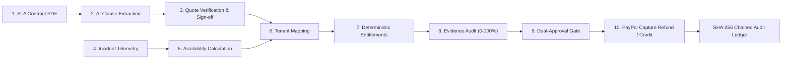
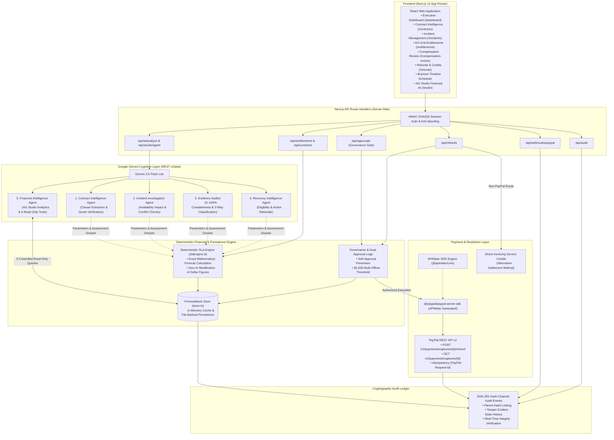

# PromiseBack — Enterprise SLA Compensation & Recovery Platform

> **"From Missed Commitments to Money Recovered."**  
> *An intelligent enterprise financial governance platform bridging SLA contract intelligence, outage telemetry investigation, deterministic financial calculation, dual-approval governance, automated PayPal restitution, and cryptographic SHA-256 audit chaining.*

[](https://nextjs.org/)
[](https://www.typescriptlang.org/)
[](https://tailwindcss.com/)
[](https://developer.paypal.com/)
[](https://www.apimatic.io/)
[](https://ai.google.dev/)
[](https://www.ag-grid.com/)
[](https://www.ag-grid.com/)
[](https://www.bryntum.com/products/scheduler/)
[](#20-copyright)

---

## 1. Project Overview

**PromiseBack** is an enterprise-grade SLA (Service Level Agreement) recovery and financial governance platform built for the **PayPal AI Hackathon 2026**. 

In modern cloud computing and mission-critical SaaS, contractual uptime commitments are standard practice. However, when service disruptions occur, the process of claiming, auditing, and disbursing compensation is broken. Contracts remain dormant inside legal document repositories, outage calculations require manual log forensics across disjointed monitoring systems, and financial reconciliations take months of friction-filled negotiations.

PromiseBack automates this entire lifecycle:
```
CONTRACT → INCIDENT → INVESTIGATION → RECOVERY ANALYSIS → FINANCIAL VALIDATION → HUMAN APPROVAL → PAYPAL EXECUTION → AUDIT
```

The platform combines **Google Gemini** for semantic contract parsing and forensic evidence auditing with an isolated **deterministic financial engine** that guarantees mathematical exactness, **institutional dual-approval governance**, automated **PayPal REST API v2 capture refunds**, and a tamper-evident **SHA-256 hash-chained audit ledger**.

---

## 2. Problem Statement

Across enterprise cloud infrastructure and SaaS agreements, an estimated **$12+ billion in legitimate SLA remedies go unclaimed annually**. The root causes stem from four systemic friction points:

1. **Dormant Contracts**: Service Level Agreements and complex remedy schedules sit trapped in static PDF files and legal addenda, inaccessible to automated operational systems.
2. **Unclaimed Breaches & Expired Deadlines**: Outage events occur, but enterprise customers fail to identify affected covenants or miss strict 15- to 30-day contractual claim submission windows.
3. **Manual, Error-Prone Entitlement Audits**: Finance and DevOps teams spend days manually cross-referencing monitoring metrics against multi-tiered SLA compensation matrices, leading to disputes over maintenance windows and downtime definitions.
4. **Delayed Restitution & Lost Trust**: Even when breaches are acknowledged, issuing financial remedies via traditional billing adjustments is cumbersome and delayed, souring customer relationships.

---

## 3. Solution

PromiseBack transforms reactive, contentious SLA disputes into a proactive, trusted financial governance pipeline:

- **Automated Contract Ingestion**: Ingests master SLA agreements and legal PDFs, extracting availability covenants, penalty tier escalations, and claim deadlines via Google Gemini, reinforced by **verbatim source quotation verification**.
- **Forensic Outage Telemetry Analysis**: Correlates infrastructure incident telemetry against active contracts, calculating exact monthly availability impact and identifying scheduled maintenance windows.
- **Quantitative Evidence Auditing**: Audits incident evidence dossiers, producing an objective **0–100% Evidence Completeness Score** with three-way classification (`VERIFIED`, `CONTRADICTORY`, `MISSING`).
- **Mathematical Separation Invariant**: Enforces a strict architectural firewall where AI provides legal interpretation, but an isolated deterministic engine computes exact dollar amounts, eliminating financial hallucination.
- **Institutional Dual-Approval Governance**: Bars creator self-approval and escalates high-value claims (exceeding `$2,500.00`) to mandatory multi-officer sign-off.
- **Automated Electronic Restitution**: Executes direct disbursements via **PayPal REST API v2 Capture Refunds** against the customer's original subscription capture, or issues direct invoicing service credits.
- **Cryptographic Auditability**: Anchors every state mutation into a tamper-evident **SHA-256 parent-hash-chained audit ledger** with real-time integrity verification.

---

## 4. Key Features

- **AI Contract Intelligence**: Structured extraction of uptime targets, measurement cycles, penalty tiers, cure periods, and claim windows, with sliding-window quotation validation against source text.
- **Incident Telemetry Forensics**: 30-day net availability impact calculation ($\frac{43,200 - \text{downtime}}{43,200} \times 100$), timeline conflict checks, and separation of confirmed facts from operational inferences.
- **Evidence Auditor**: Quantitative 0–100% completeness scoring with three-way classification (`VERIFIED`, `CONTRADICTORY`, `MISSING`), risk factor detection, and legal sufficiency rationales.
- **Deterministic SLA Calculation Engine**: Absolute mathematical authority over currency figures ($14,500 base × 10% Tier 1 = $1,450.00); AI models cannot invent, round, or alter payout amounts.
- **Multi-Officer Dual-Approval Governance**: Configurable approval threshold ($2,500.00); mandatory second authorized officer for large disbursements; creator self-approval prevention.
- **PayPal REST API v2 Capture Refunds**: Direct electronic refund execution against verified captures using the APIMatic-generated PayPal Server SDK, protected by server-side idempotency keys.
- **Alternative Invoice Service Credit Settlement**: Supports contractually specified non-electronic remedies with automated billing deduction tracking.
- **AG Grid High-Density Data Table**: Enterprise-grade entitlements table on `/entitlements` with column sorting, filtering, and custom cell status renderers.
- **AG Studio Financial Intelligence**: Natural-language analytical chat on `/studio` equipped with 6 controlled read-only database query tools and an immutable financial execution refusal guardrail.
- **Bryntum Scheduler Outage Timeline**: Visualizes incident progressions, canary probe latency degradation, and maintenance windows on `/incidents`.
- **SHA-256 Hash-Chained Audit Ledger**: Cryptographically chained audit event stream with parent hash verification and on-demand tamper detection.

---

## 5. End-to-End Recovery Pipeline

The platform coordinates a 10-step recovery pipeline:



1. **SLA Contract Ingestion**: Ingests PDF agreements or structured contractual definitions.
2. **AI Clause Extraction**: Gemini extracts uptime covenants, penalty tier escalations, and claim deadlines into structured JSON schemas.
3. **Quote Verification & Human Sign-off**: Verifies extracted quotes verbatim against raw document text; compliance officers verify clauses.
4. **Incident Telemetry Ingestion**: Captures outage telemetry, duration, impacted service endpoints, and error rates.
5. **Availability Calculation**: Calculates net monthly availability percentage and evaluates pre-scheduled maintenance exclusion windows.
6. **Customer Tenant Mapping**: Maps impacted services and infrastructure regions to affected enterprise customer accounts.
7. **Deterministic Entitlements Engine**: Evaluates breach magnitude against contractual compensation tiers to compute exact monetary remedies.
8. **Forensic Evidence Audit**: Computes an objective 0–100% completeness score and categorizes evidence into Verified, Contradictory, and Missing items.
9. **Dual-Approval Gate**: Evaluates payout thresholds ($2,500.00) and enforces separation of duties before financial authorization.
10. **Restitution & Cryptographic Audit**: Issues a PayPal REST API v2 Capture Refund or invoice credit, recording the transaction on the SHA-256 hash-chained ledger.

---

## 6. Architecture

The architecture enforces a strict separation between client presentation, API routing, cognitive AI analysis, deterministic calculation, payment execution, and cryptographic auditability:



---

## 7. Technology Stack

Every technology and dependency in PromiseBack is actively integrated and verified in the codebase:

| Category | Technology | Version | Official Documentation | Role in PromiseBack |
| :--- | :--- | :--- | :--- | :--- |
| **Framework** | [Next.js](https://nextjs.org/) | `14.2.15` | [nextjs.org/docs](https://nextjs.org/docs) | App Router, React Server Components, server-side API Route Handlers. |
| **Language** | [TypeScript](https://www.typescriptlang.org/) | `5.6.3` | [typescriptlang.org/docs](https://www.typescriptlang.org/docs/) | End-to-end type safety, strict interface contracts. |
| **Styling** | [Tailwind CSS](https://tailwindcss.com/) | `3.4.14` | [tailwindcss.com/docs](https://tailwindcss.com/docs) | Design system, tokenized layout, responsive styling. |
| **Payment Rails** | [PayPal REST API v2](https://developer.paypal.com/) | `v2` | [developer.paypal.com/api/rest](https://developer.paypal.com/api/rest/) | Electronic restitution via Capture Refunds (`/v2/payments/captures/{id}/refund`). |
| **SDK Generation** | [APIMatic](https://www.apimatic.io/) | `@apimatic/core 0.10.30` | [apimatic.io/docs](https://www.apimatic.io/docs) | Generates and powers `@paypal/paypal-server-sdk` (`v2.5.0`) with schema validation. |
| **AI / LLM** | [Google Gemini](https://ai.google.dev/) | `REST v1beta` | [ai.google.dev/docs](https://ai.google.dev/docs) | Multi-agent reasoning layer (`gemini-3.5-flash-lite`) with JSON Schema structured outputs. |
| **Data Grid** | [AG Grid](https://www.ag-grid.com/) | `36.3.0` | [ag-grid.com/react-data-grid](https://www.ag-grid.com/react-data-grid/) | High-density entitlements table (`ag-grid-react`, Quartz theme) on `/entitlements`. |
| **Financial AI Studio** | [AG Studio](https://www.ag-grid.com/) | `3.1.0` | [ag-grid.com](https://www.ag-grid.com/) | Interactive conversational financial analytics studio (`ag-studio-react`) on `/studio`. |
| **Timeline Scheduling** | [Bryntum Scheduler](https://www.bryntum.com/products/scheduler/) | `7.3.8` | [bryntum.com/products/scheduler/docs](https://www.bryntum.com/products/scheduler/docs/) | Outage, detection lag, and maintenance timeline component on `/incidents`. |
| **Document Parsing** | [pdf-parse](https://www.npmjs.com/package/pdf-parse) | `2.4.5` | [npmjs.com/package/pdf-parse](https://www.npmjs.com/package/pdf-parse) | Server-side PDF text buffer extraction for SLA contract ingestion. |
| **Cryptography** | [Node.js Crypto](https://nodejs.org/api/crypto.html) | Native | [nodejs.org/api/crypto.html](https://nodejs.org/api/crypto.html) | HMAC-SHA256 session management and parent-hash-chained audit logging. |

> [!NOTE]
> **AG Grid** and **AG Studio** are distinct products from the same vendor. AG Grid provides the tabular data grid on the `/entitlements` screen, while AG Studio provides the conversational analytics workbench on the `/studio` screen.

---

## 8. Application Screens and Routes

| Screen Name | Route | Implemented Capabilities |
| :--- | :--- | :--- |
| **Root Redirect** | `/` | Redirects to `/dashboard`. |
| **Executive Dashboard** | `/dashboard` | SLA recovery overview, KPI metric cards, 30-day time-series availability chart vs. 99.95% target, recent incidents table, and operational intelligence feed. |
| **Contract Intelligence** | `/contracts` | SLA agreement directory, drag-and-drop PDF ingestion modal, commitment extraction, and clause-level verification registry. |
| **Incident Intelligence** | `/incidents` | Outage event timeline, synthetic telemetry probes (availability, latency, error rate), and Bryntum Scheduler view. |
| **Customer Entitlements** | `/entitlements` | High-density AG Grid data table with status filters, currency formatting, and detail slide-over drawers. |
| **Compensation Review** | `/compensation-review` | Two-column investigation workbench (Contract Obligation vs. Telemetry Evidence), AI Evidence Completeness Score badge (0–100%), and approval actions. |
| **Refunds & Credits** | `/refunds` | Distinct tabs for PayPal Capture Refunds vs. Invoice Service Credits, transaction detail inspector, and live PayPal payload viewer. |
| **Audit Trail** | `/audit` | Chronological event ledger with SHA-256 cryptographic parent hash chaining and live on-demand integrity verification button. |
| **Protected Customers** | `/customers` | Enterprise tenant directory with assigned SLA tiers, monthly spend, refundable capture balances, and preferred payout methods. |
| **System Settings** | `/settings` | PayPal Sandbox credentials status, dual-approval financial threshold configuration, and webhook endpoints. |
| **Financial Studio** | `/studio` | AG Studio interactive chat interface powered by 6 controlled read-only database tools with financial security guardrails. |
| **Operator Login** | `/login` | Secure operator login supporting environment-configured credentials and HMAC-signed session cookies. |

---

## 9. AI Agent Architecture

PromiseBack implements 5 specialized cognitive agents located in [`src/lib/ai/`](src/lib/ai/). Each agent has a distinct analytical boundary and operates via Google Gemini REST APIs (`v1beta`):

```
src/lib/ai/
├── geminiClient.ts      # Resilient REST client with schema validation & latency fallback
├── contractAgent.ts     # 1. Contract Intelligence Agent
├── incidentAgent.ts     # 2. Incident Investigation Agent
├── evidenceAuditor.ts   # 3. Forensic Evidence Auditor
├── recoveryAgent.ts     # 4. Recovery Intelligence Agent
├── financialAgent.ts    # 5. Studio Financial Intelligence Agent
└── index.ts             # Barrel export
```

### The 5 Cognitive Agents

1. **Contract Intelligence Agent (`src/lib/ai/contractAgent.ts`)**
   - **Role**: Ingests full-text and PDF SLA agreements.
   - **Capabilities**: Extracts monthly availability targets (e.g., 99.95%), tiered penalty schedules, measurement intervals, cure periods, and claim submission deadlines.
   - **Verbatim Quote Validation**: Executes `validateSourceQuoteInText` to verify that extracted clauses exist verbatim in the source document, flagging unverified terms to prevent hallucination.
   - Computes contractual downtime allowances (e.g., 99.95% allows at most 21.6 minutes/month).

2. **Incident Investigation Agent (`src/lib/ai/incidentAgent.ts`)**
   - **Role**: Telemetry forensics and contractual breach correlation.
   - **Capabilities**: Calculates 30-day net availability impact: $\text{Availability} = \frac{43,200 - \text{downtime}}{43,200} \times 100$.
   - **Timestamp Anomaly Detection**: Flags chronology inversions, future timestamps, or negative durations via `checkTimestampConsistency`.
   - Identifies scheduled maintenance exclusion windows (`isMaintenanceWindow`).
   - Separates **Confirmed Facts** from **Assumptions and Inferences** to prevent unfounded liability declarations.

3. **Evidence Auditor (`src/lib/ai/evidenceAuditor.ts`)**
   - **Role**: Forensic evidentiary completeness auditing.
   - **Three-Way Classification**: Categorizes all evidence items into `VERIFIED`, `CONTRADICTORY`, or `MISSING`.
   - Computes an objective **Evidence Completeness Score (0–100%)**.
   - Identifies evidentiary risks and provides human-readable legal sufficiency explanations.

4. **Recovery Intelligence Agent (`src/lib/ai/recoveryAgent.ts`)**
   - **Role**: Formulates actionable recovery recommendations for review officers.
   - **Eligibility Analysis**: Evaluates available evidence against contract eligibility conditions.
   - **Mathematical Boundary Invariant**: The agent **does not calculate or alter currency figures**. It cites the exact dollar entitlement calculated by the deterministic `slaEngine.ts`.
   - Checks the `$2,500.00` dual-approval threshold and selects the appropriate restitution channel.

5. **Financial Intelligence Agent (`src/lib/ai/financialAgent.ts`)**
   - **Role**: Conversational analytical assistant in AG Studio.
   - Equipped with **6 controlled, read-only database query tools**:
     - `getFinancialSummary()`: Aggregate liability, pending remedies, and disbursed refunds.
     - `getTopExposureCustomers()`: Customer exposure ranking.
     - `getApproachingDeadlines()`: Cases approaching claim submission deadlines.
     - `getConflictingIncidents()`: Incidents with missing or contradictory evidence.
     - `getServiceReliability()`: Historical service degradation statistics.
     - `getCaseHistory()`: Deep-dive compensation case records.
   - Cites real record identifiers (`CASE-...`, `INC-...`, `SLA-...`).
   - **Immutable Security Guardrail**: Enforces a hardcoded refusal to execute autonomous disbursements or modify financial records.

---

## 10. PayPal Integration

PromiseBack integrates with PayPal using technically accurate payment primitives:

### PayPal REST API v2 Capture Refunds

The primary automated restitution mechanism is **PayPal REST API v2 Capture Refunds**:
```http
POST /v2/payments/captures/{capture_id}/refund
```

When an enterprise customer subscribes to a service, their subscription or fee is captured under a PayPal Capture ID (e.g., `2GG10928AB778901C`). When an SLA breach is approved for restitution, PromiseBack executes a capture refund directly against that original payment capture.

- **SDK Engine**: Powered by `@paypal/paypal-server-sdk` (`v2.5.0`), officially generated by **APIMatic** using `@apimatic/core` and `@apimatic/schema`.
- **Idempotency Protection**: Every refund request passes a unique `PayPal-Request-Id` header (composed as `cust-id:billing-period:inc-id`) to guarantee that network retries never cause duplicate refunds.
- **Balance Validation**: Pre-validates that the requested refund does not exceed the capture's remaining refundable balance before dispatching the API call.
- **Webhook Reconciliation**: Inbound webhooks (`PAYMENT.CAPTURE.REFUNDED`) are cryptographically verified against PayPal's verification endpoint (`POST /v1/notifications/verify-webhook-signature`) and recorded idempotently.

### Clear Distinction of Restitution Channels

| Restitution Method | Technical Mechanism | Implementation Status |
| :--- | :--- | :---: |
| **PayPal Capture Refunds** | Reverses funds from a previously captured PayPal payment via `POST /v2/payments/captures/{id}/refund`. | **IMPLEMENTED & OPERATIONAL** |
| **Invoice Service Credits** | Applies a credit balance against the customer's next billing invoice via deterministic ledger deduction. | **IMPLEMENTED & OPERATIONAL** |
| **PayPal Payouts** | Outbound mass disbursement from a business account balance via `POST /v1/payments/payouts`. | **NOT IMPLEMENTED** (Roadmap) |

> [!IMPORTANT]
> PromiseBack executes **PayPal capture refunds** and **invoice service credits**. It does **not** use the PayPal Payouts API. Claims and documentation strictly reflect capture refunds.

---

## 11. Financial Governance and Security

PromiseBack implements verifiable institutional financial controls:

- **Human-Controlled Approval Gate**: No financial disbursement or invoice credit can occur autonomously. Every case requires explicit human review.
- **Dual-Officer Approval Threshold**: Payouts exceeding the configured threshold (default: **$2,500.00**) mandate two distinct authorized officers (First Reviewer + Second Approving Officer).
- **Prevention of Creator Self-Approval**: The officer who initiates or requests a compensation case is cryptographically prohibited from authorizing or approving it.
- **HMAC-SHA256 Session Management**: Operator sessions use tamper-evident, HMAC-SHA256 signed session cookies. Requests lacking valid credentials or attempting client header spoofing (`x-promiseback-client`) are rejected with HTTP 401.
- **Server-Side Credential Isolation**: All API keys, PayPal secrets, and session signing keys are strictly maintained in server-side environment variables and are never bundled into client-side JavaScript.
- **Idempotent Mutation Guards**: Mutations use cryptographic idempotency keys, preventing duplicate financial execution from network retries or double clicks.

> [!NOTE]
> These governance controls represent engineering safeguards implemented for the hackathon demonstration. They do not constitute formal banking certifications or complete legal/regulatory compliance.

---

## 12. Audit Trail and SHA-256 Integrity

Every lifecycle action in PromiseBack generates an immutable audit record:

### Cryptographic Chaining Specification

Each audit event incorporates the SHA-256 hash of the immediately preceding event:
$$\text{Hash}_n = \text{SHA-256}(\text{Index}_n \parallel \text{Timestamp}_n \parallel \text{EventType}_n \parallel \text{PayloadJSON}_n \parallel \text{Hash}_{n-1})$$

The genesis event begins with a known seed hash (`0000000000000000000000000000000000000000000000000000000000000000`).

### On-Demand Ledger Verification

The `/audit` screen includes a **"Verify Ledger Integrity"** capability (`GET /api/audit`). The verification engine traverses the entire chain from genesis to the latest record, recomputing hashes and validating parent linkages. Any modification, reordering, or deletion of a past record immediately breaks the hash chain and flags the exact corrupted event index.

---

## 13. API Reference

All API routes are implemented as Next.js Route Handlers under `src/app/api/`:

| Endpoint | Method | Auth Required | Description |
| :--- | :---: | :---: | :--- |
| `/api/stats` | `GET` | No | Returns dashboard KPI metrics and 30-day availability time-series data. |
| `/api/contracts` | `GET` | No | Lists all SLA contracts with optional status and search filters. |
| `/api/contracts` | `POST` | Yes | Ingests a new contract via PDF file upload or structured JSON. |
| `/api/contracts/[id]` | `GET` | No | Retrieves detailed contract data, including extracted clauses and verification status. |
| `/api/contracts/[id]` | `PATCH` | Yes | Updates clause verification status (`human_verified`, `requires_review`). |
| `/api/incidents` | `GET` | No | Queries outage incidents with severity, status, and text search filters. |
| `/api/incidents` | `POST` | Yes | Ingests an outage incident with duration, service, and telemetry data. |
| `/api/incidents/[id]` | `GET` | No | Retrieves full incident record, timeline events, and canary probe metrics. |
| `/api/incidents/[id]` | `PATCH` | Yes | Updates incident status or details. |
| `/api/entitlements` | `GET` | No | Lists calculated customer compensation cases with status and customer filters. |
| `/api/approvals` | `POST` | Yes | Processes an approval decision (`approved`, `rejected`, `review_requested`) with dual-officer enforcement. |
| `/api/refunds` | `GET` | No | Retrieves all refund records, invoice service credits, and sandbox status. |
| `/api/refunds` | `POST` | Yes | Executes PayPal capture refunds (`action: 'execute_paypal'`), applies service credits (`action: 'apply_credit'`), or creates partial refunds. |
| `/api/audit` | `GET` | No | Retrieves audit event ledger and performs cryptographic chain integrity verification. |
| `/api/ai/analyze` | `POST` | Optional | Runs context-aware AI analysis (`contract`, `incident`, `entitlement`, `evidence`) via Gemini agents. |
| `/api/studio/agent` | `POST` | Optional | Runs the conversational Financial Intelligence Agent in AG Studio with read-only tools. |
| `/api/webhooks/paypal` | `POST` | Signature | Receives and verifies inbound PayPal webhook events (`PAYMENT.CAPTURE.REFUNDED`). |
| `/api/auth/session` | `GET` | No | Inspects current operator authentication session state. |
| `/api/auth/session` | `POST` | No | Authenticates an operator using username/password, issuing a signed HMAC cookie. |
| `/api/auth/session` | `DELETE` | No | Logs out the operator by clearing the session cookie. |
| `/api/customers` | `GET` | No | Lists customer tenant profiles, SLA contract mappings, and refundable capture balances. |
| `/api/checkout` | `GET` / `POST` | Optional | Sandbox utility to create and inspect test PayPal checkout orders for capture generation. |

---

## 14. Demo Scenario

The application includes a pre-seeded, end-to-end demonstration scenario:

> [!NOTE]
> **Demonstration Data Notice**: The scenario below uses synthetic enterprise records seeded in [`data/store.demo.json`](data/store.demo.json) for hackathon evaluation purposes. It does not reflect a real outage suffered by an actual corporation.

### The Seeded Scenario

- **Customer**: Acropora Cloud Infrastructure Inc. / Apex Fintech Solutions Inc. (`cust-101`)
- **Contract Number**: `SLA-2026-AF88` (Enterprise Mission-Critical Gold SLA)
  - Contracted Monthly Uptime Target: **99.95%**
  - Monthly Recurring Fee: **$14,500.00**
  - Claim Submission Window: **30 days**
  - Penalty Tier 1: **99.50% – 99.94%** $\rightarrow$ **10% credit**
  - Payout Election: **PayPal Refund** against capture `2GG10928AB778901C`
- **Incident Number**: `INC-2026-0314`
  - Impacted Service: Core Transaction Routing & Payment Webhook Ingestion
  - Severity: **P1 – Critical**
  - Outage Duration: **38 minutes**
  - Root Cause: Connection pool deadlock on `transactions_ledger` primary replica
- **Net Availability Calculation**:
  $$\text{Availability} = \frac{43,200 - 38}{43,200} \times 100 = 99.912\%$$
  $99.912\% < 99.95\%$ target $\rightarrow$ **Breach Confirmed**, activating Tier 1 (10% credit).
- **Exact Entitlement Remedy**:
  $$\text{Remedy Amount} = \$14,500.00 \times 10\% = \mathbf{\$1,450.00}$$
- **Evidence Completeness Score**: **85/100** (3 verified items: telemetry metrics, clause 4.3 authority, root cause; 1 missing item: maintenance calendar check; 0 contradictions).
- **Dual-Approval Evaluation**: Payout amount ($1,450.00) is below the $2,500.00 threshold, allowing single-officer sign-off while preventing creator self-approval.
- **PayPal Execution**: Disbursed via PayPal REST API v2 Capture Refund against capture `2GG10928AB778901C`.
- **Audit Verification**: Recorded as an immutable event chained via SHA-256 parent hash with verified ledger integrity.

---

## 15. Installation and Setup

### Prerequisites

- **Node.js**: `v18.0.0` or higher (`v20.x` recommended)
- **npm**: `v9.0.0` or higher
- **Git**

### Step-by-Step Installation

```bash
# 1. Clone the repository
git clone https://github.com/shivam-more1609/PromiseBack.git
cd PromiseBack

# 2. Install dependencies
npm install

# 3. Create local environment configuration
cp .env.example .env.local
```

---

## 16. Environment Variables

Configure your credentials in `.env.local`. **Never commit `.env.local` to version control.**

```env
# =================================================================
# PromiseBack Environment Configuration (.env.local)
# =================================================================

# Server-Side Administrator Credentials (Hackathon Demo Login)
ADMIN_USERNAME=admin
ADMIN_PASSWORD=your_secure_password_here

# Security Keys (Server-Side Only)
PROMISEBACK_API_KEY=0aaeb2d7c41c06ab4b2c608f2914dce6db237203ddf112a578fda7bc3ee8edf2
SESSION_SECRET=f4897ebfae1844a86c81bfc6ed482351069c4284d4cdec785671a274041dd0e2

# Google Gemini API (Required for Live AI Agents)
# Supported models: gemini-3.5-flash-lite, gemini-3.1-flash-lite, gemini-3-flash-preview
GEMINI_API_KEY=your_gemini_api_key_here
GEMINI_MODEL=gemini-3.5-flash-lite

# PayPal Developer Sandbox (Optional - fallback simulation available if omitted)
# Retrieve from https://developer.paypal.com/dashboard/applications/sandbox
PAYPAL_SANDBOX_CLIENT_ID=your_paypal_sandbox_client_id
PAYPAL_SANDBOX_CLIENT_SECRET=your_paypal_sandbox_client_secret
PAYPAL_SANDBOX_WEBHOOK_ID=your_paypal_sandbox_webhook_id

# Base Application URL
NEXT_PUBLIC_APP_URL=http://localhost:3000
```

> [!TIP]
> If `PAYPAL_SANDBOX_CLIENT_ID` and `PAYPAL_SANDBOX_CLIENT_SECRET` are not configured, the platform safely detects this and provides clear UI status indicators explaining that sandbox credentials are required for live PayPal API calls.

---

## 17. Running Locally

### Development Mode

Run the local Next.js development server with hot-reloading:
```bash
npm run dev
```
Open [http://localhost:3000](http://localhost:3000) in your browser.

### Production Build & Execution

Build the optimized production application and run it locally:
```bash
# Build the production bundle (checks TypeScript, ESLint, and compiles static pages)
npm run build

# Start the Next.js production server
npm start
```
Open [http://localhost:3000](http://localhost:3000) in your browser.

---

## 18. Testing

PromiseBack includes an automated verification harness covering SLA mathematics, financial guardrails, contract intelligence, PayPal capture refunds, dual-officer governance, webhook reconciliation, and cognitive AI agents.

Run all 13 automated test suites:
```bash
npm test
```

### Automated Test Suite Coverage

```
=== RUNNING ALL 13 TEST SUITES ===

Executing: tests/sla-calculation.test.ts ......... ✅ PASSED
Executing: tests/financial-security.test.ts ...... ✅ PASSED
Executing: tests/contract-extraction.test.ts ..... ✅ PASSED
Executing: tests/paypal-integration.test.ts ...... ✅ PASSED
Executing: tests/e2e-workflow.test.ts ............ ✅ PASSED
Executing: tests/second-review.test.ts ........... ✅ PASSED
Executing: tests/third-review.test.ts ............ ✅ PASSED
Executing: tests/sponsor-integrations.test.ts .... ✅ PASSED
Executing: tests/webhook-reconciliation.test.ts .. ✅ PASSED
Executing: tests/redirect-persistence.test.ts .... ✅ PASSED
Executing: tests/ledger-reconciliation.test.ts ... ✅ PASSED
Executing: tests/dual-approval-governance.test.ts  ✅ PASSED
Executing: tests/ai-intelligence-layer.test.ts ... ✅ PASSED

========================================
TEST SUITE RESULTS: 13/13 PASSED
========================================
```

---

## 19. Future Scope

To maintain complete transparency for hackathon evaluation, the table below distinguishes between what is implemented today versus future roadmap goals:

| Feature / Integration | Current Status | Architecture & Implementation Details |
| :--- | :---: | :--- |
| **Google Gemini Cognitive Layer** | **IMPLEMENTED** | 5 specialized agents with structured output schemas and quote verification. |
| **Deterministic SLA Math Engine** | **IMPLEMENTED** | Isolated mathematical calculation engine; zero AI hallucination of money. |
| **Dual-Approval Governance** | **IMPLEMENTED** | Self-approval prevention and $2,500 multi-officer threshold gate. |
| **PayPal REST v2 Capture Refunds** | **IMPLEMENTED** | APIMatic SDK integration (`POST /v2/payments/captures/{id}/refund`) with idempotency. |
| **SHA-256 Chained Audit Ledger** | **IMPLEMENTED** | Parent-hash-chained audit ledger with on-demand verification. |
| **AG Grid & AG Studio** | **IMPLEMENTED** | High-density data grid on `/entitlements` and conversational analytics on `/studio`. |
| **Bryntum Scheduler** | **IMPLEMENTED** | Outage timeline and maintenance window scheduler on `/incidents`. |
| **Datadog / CloudWatch Telemetry** | **DEMONSTRATION** | Ingested incident records contain synthetic canary probe metrics and time-series points. |
| **Live Monitoring Webhook Ingestion** | **PLANNED** | Real-time inbound webhook adapters for Datadog, AWS CloudWatch, and PagerDuty alerts. |
| **Multi-Party SLA Nodes** | **PLANNED** | Cryptographic multi-party ledger nodes shared between vendors and enterprise clients. |
| **PayPal Payouts Batch API** | **PLANNED** | Outbound mass payouts for multi-tenant incidents impacting thousands of customers simultaneously. |

---

## 20. Copyright

Copyright © 2026 Shivam More. All rights reserved.

PromiseBack is publicly accessible for hackathon evaluation and demonstration purposes. Public access to this repository does not grant permission to copy, modify, redistribute, sublicense, or commercially exploit the software without prior written permission from the copyright holder.
